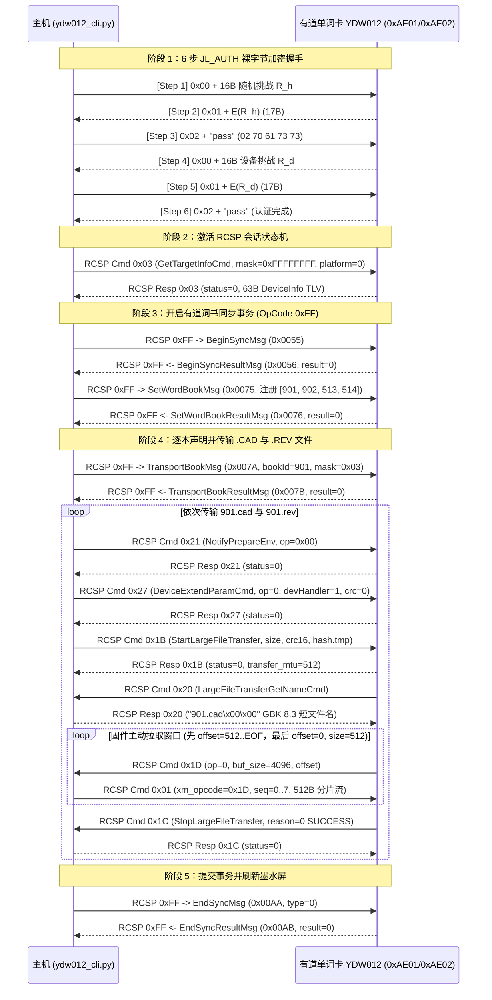

# 网易有道电子单词卡 YDW012 独立蓝牙同步工具与逆向工程文档
# NetEase Youdao E-Ink Word Card (YDW012) Standalone BLE Tool & Reverse-Engineering Guide

[](LICENSE)
[](https://www.python.org/)
[](docs/REVERSE_ENGINEERING.md)

无需手机 App（`有道智慧学习`）、无需云端账号、无需安卓模拟器，通过 Linux / macOS / Windows 蓝牙 (BLE) 直接向 **网易有道电子单词卡 YDW012** 编译并推送任意自定义中英双语词书（`.CAD` 词卡库 + `.REV` 艾宾浩斯复习计划），支持卡内 FAT 文件系统浏览与原卡词书无损提取。

---

## 目录 (Table of Contents)

- [项目背景与核心特性](#项目背景与核心特性)
- [快速开始 (Quick Start)](#快速开始-quick-start)
- [所有遇到的问题、排障流程与关键突破点总结](#所有遇到的问题排障流程与关键突破点总结)
- [完整同步协议流水线 (Mermaid 时序图)](#完整同步协议流水线-mermaid-时序图)
- [二进制文件格式概览 (`.CAD` & `.REV`)](#二进制文件格式概览-cad--rev)
- [仓库目录结构](#仓库目录结构)
- [深度逆向工程文档](#深度逆向工程文档)

---

## 项目背景与核心特性

网易有道电子单词卡 **YDW012** 是一款基于 **杰理 (Jieli / 珠海杰理科技) 双模蓝牙 SoC** 的墨水屏便携单词设备。由于以下原因，用户在日常使用中极难向卡片导入自定义专业词库：
1. **Type-C 接口仅供电**：板载 USB Type-C 接口仅连接充电管理芯片，**没有连接 D+/D- 数据线**（插入电脑执行 `lsusb` 无任何 USB 设备枚举），蓝牙 BLE 是唯一的数据通信接口。
2. **官方 App 停服且与新版 Android 不兼容**：旧版 `com.youdao.wisdom` APK 针对低版本 Android TargetSDK 构建，现代手机无法直接安装，且官方未开放任何离线自定义词书编译格式。

本项目通过对 APK 内的 `libjl_auth.so` 原生加密库、`classes3.dex`（杰理 `jl_rcsp` 协议栈）与 `classes8.dex`（有道 `0xFF` 私有业务消息层）以及真实卡内提取出的 `.CAD` / `.REV` 词书样本进行完整逆向，实现了 **100% 纯 Python 独立命令行工具 (`ydw012_cli.py`)**：

- **零配置自动发现 (`scan`)**：自动扫描周围广播名为 `YDW:GD4170...` 或包含服务 UUID `0000ae00-0000-1000-8000-00805f9b34fb` 的单词卡，无需硬编码 MAC 地址。
- **6 步 `JL_AUTH` 硬件挑战-应答认证**：纯 Python 还原 `libjl_auth.so` 中的 8 轮双相 S-Box / Fibonacci 置换分组密码与密钥调度器。
- **完整 RCSP + 有道 `0xFF` 协议栈**：支持查询卡内已激活词书 (`info`)、浏览卡内 FAT 文件系统 (`ls`)、按簇号无损导出卡内文件 (`pull`)、高速大文件分块写入 (`upload`，实测约 8 KB/s)。
- **100% Bit-Accurate `.CAD` / `.REV` 编译器与反编译器 (`build` / `inspect`)**：支持将任意 JSON 词表编译为单词卡原生识别的 `<book_id>.cad` 与 `<book_id>.rev`（内置艾宾浩斯 `[0, 2, 6, 14, 29, 39]` 周期复习计划生成）。
- **开箱即用双语专业词库**：内置两套完整中英双语词库：
  - `examples/sim4options_words.json`：**130 个期权交易与希腊字母核心概念词卡**（Book ID `901`）
  - `examples/sim4director_words.json`：**16 大分类共 341 个影视导演与镜头调度专业词卡**（Book ID `902`）

---

## 快速开始 (Quick Start)

### 1. 安装依赖

```bash
pip install -r requirements.txt
# 或者使用 uv:
uv pip install bleak
```

### 2. 唤醒单词卡并扫描设备

按一下有道电子单词卡侧边按键点亮墨水屏（确保屏幕右上角无休眠断连状态），然后运行：

```bash
python3 ydw012_cli.py scan
```

输出示例：
```text
Scanning BLE for 8.0s...
  [MATCH] XX:XX:XX:XX:XX:XX  name='YDW:GD4170XXXXXXXXXX'  RSSI=-54  uuids=['0000ae00-0000-1000-8000-00805f9b34fb']
```

> **提示**：所有命令默认支持 `--addr auto` 自动扫描匹配 `YDW:` 前缀设备；也可以通过 `--addr XX:XX:XX:XX:XX:XX` 或环境变量 `export YDW012_ADDR=XX:XX:XX:XX:XX:XX` 指定固定 MAC 地址。

### 3. 查询卡内当前词书与学习进度 (`info`)

```bash
python3 ydw012_cli.py info
```

### 4. 浏览卡内 FAT 文件系统 (`ls`) 与提取文件 (`pull`)

```bash
# 递归列出卡内 FAT 根目录与 /O/<book_id>/ 下的所有 .CAD / .REV / .STU 文件及其簇号 (cluster)
python3 ydw012_cli.py ls

# 按簇号从卡内无损导出任意文件（带逐包 CRC16-XMODEM 校验）
python3 ydw012_cli.py pull 660 backup_513.cad
```

### 5. 仅在本地编译并校验自定义词书 (`build` & `inspect`)

```bash
# 将 JSON 词表编译为 901.cad 和 901.rev
python3 ydw012_cli.py build \
  --json examples/sim4options_words.json \
  --book-id 901 \
  --title "sim4options期权双语" \
  --daily 15 \
  --out-dir ./build

# 反编译校验生成的二进制文件结构与 CRC16
python3 ydw012_cli.py inspect ./build/901.cad
python3 ydw012_cli.py inspect ./build/901.rev
```

### 6. 一键编译并蓝牙直推词书到单词卡 (`upload`)

```bash
# 默认一键编译并推送内置的两本双语词书 (901 期权双语 + 902 导演双语)，同时保留卡内原有词书 (最多共 4 本)
python3 ydw012_cli.py upload

# 或者指定任意自定义词书上传：
python3 ydw012_cli.py upload \
  --book 901 "sim4options期权双语" examples/sim4options_words.json \
  --book 902 "sim4director导演双语" examples/sim4director_words.json
```

---

## 所有遇到的问题、排障流程与关键突破点总结

在从零打通 YDW012 独立蓝牙同步的过程中，我们先后遭遇并攻克了 **8 个关键硬件与协议层陷阱**（详细字节级分析见 [`docs/REVERSE_ENGINEERING.md`](docs/REVERSE_ENGINEERING.md)）：

### 陷阱 1：Type-C 接口纯供电无数据线
- **现象**：使用全功能数据线将 YDW012 插入 Linux 主机，`lsusb` 与 `dmesg -w` 均无任何新设备枚举。
- **排障与突破**：确认硬件 Type-C 母座仅焊接了 VBUS/GND 充电引脚，无 USB D+/D- 差分线。设备对外广播 BLE 名称 `YDW:GD4170XXXXXXXXXX`，GATT 服务 `0xAE00`（Write: `0xAE01`, Notify: `0xAE02`）是唯一的固件通信与文件刷写通道。

### 陷阱 2：连接后直接发送 RCSP 指令全部静默超时 (Silent Drop #1 — 缺少 `JL_AUTH` 6 步握手)
- **现象**：连接 `0xAE01` 并开启 `0xAE02` Notify 后，直接发送标准杰理 RCSP 帧（`FE DC BA ... EF`），设备没有任何回复，数秒后主动断开 BLE 连接。
- **排障与突破**：反编译 `libjl_auth.so` 发现，BLE 链路建立后，固件处于未认证隔离态，必须在 **`0xAE01` / `0xAE02` 上直接收发不带 `FE DC BA` 头部的裸字节流** 完成 **6 步双向挑战-应答握手**：
  1. Host -> Device (`0xAE01`)：`0x00` + 16 字节随机挑战 `R_h`（共 17 字节）
  2. Device -> Host (`0xAE02`)：`0x01` + `E(R_h)`（17 字节，Host 校验设备合法性）
  3. Host -> Device (`0xAE01`)：`02 70 61 73 73`（即 `b"\x02pass"`，5 字节）
  4. Device -> Host (`0xAE02`)：`0x00` + 16 字节设备随机挑战 `R_d`（17 字节）
  5. Host -> Device (`0xAE01`)：`0x01` + `E(R_d)`（17 字节，设备校验 Host 合法性）
  6. Device -> Host (`0xAE02`)：`02 70 61 73 73`（`b"\x02pass"`，认证正式通过！）

### 陷阱 3：认证通过后发 `0xFF` 业务指令或 `0x0C` 目录浏览依然静默丢弃 (Silent Drop #2 — 缺少 `GetTargetInfoCmd 0x03`)
- **现象**：完成 6 步握手收到 `02 70 61 73 73` 后，直接发送有道自定义指令 `0xFF`（如 `GetTaskWordBookMsg 0x0003`）或杰理目录浏览 `0x0C`，固件依然静默不回包。
- **排障与突破**：逆向 `RcspAuth` 与 `RcspOpImpl` 状态机发现，认证通过后**第一条 RCSP 指令必须是 `GetTargetInfoCmd (OpCode=0x03, param=0xFFFFFFFF00)`**（完整帧 `FE DC BA C0 03 00 06 01 FF FF FF FF 00 EF`）。只有收到该指令并返回 63 字节设备能力掩码后，固件才会解锁后续 `0x0C`、`0x1B`、`0x24`、`0xFF` 等所有命令处理器。

### 陷阱 4：大文件上传 `StartLargeFileTransfer (0x1B)` 返回 `status=1` 失败 (Pitfall #3 — 缺少 `DeviceExtendParamCmd 0x27`)
- **现象**：按照常规流程发送 `NotifyPrepareEnv (0x21, param=0x00)` 后直接发送 `StartLargeFileTransfer (0x1B)`，固件立即拒绝并返回 `status=1`。
- **排障与突破**：逆向 `classes3.dex` 中的 `com.jieli.jl_rcsp.task.TransferTask` 发现，在 `0x21` 与 `0x1B` 之间**必须发送 `DeviceExtendParamCmd (OpCode=0x27)`**，参数为 `struct.pack(">BIB", 0x00, dev_handler, 0x00)`（即 `00 00 00 00 01 00`，指定 `op=0` 大文件传输、目标存储句柄 `devHandler=1` SD/Flash、`hasCrc16=0`）。加上 `0x27` 后，`0x1B` 立即返回 `status=0, transfer_mtu=512`！

### 陷阱 5：文件名回调 `LargeFileTransferGetNameCmd (0x20)` 编码陷阱 (Pitfall #4 — 8.3 短文件名 vs UTF-16LE)
- **现象**：收到 `0x1B` 成功响应后，固件立即主动下发 `OpCode=0x20` (`LargeFileTransferGetNameCmd`) 向主机索要目标文件名。若按长文件名规则附加 `\U` 前缀或 UTF-16LE 编码，固件无法将词书归档到 `/O/<book_id>/<book_id>.CAD`。
- **排障与突破**：逆向 `LargeFileTransferGetNameCmd$Param.getNameData()` 发现，当主文件名 `< 9` 字节且扩展名 `< 5` 字节（标准 8.3 短文件名，如 `901.cad`、`901.rev`）时，必须直接返回 **`filename.encode("gbk") + b"\x00\x00"`**（例如 `901.cad` 对应 `39 30 31 2E 63 61 64 00 00`）。固件收到后会自动根据扩展名 `.cad` / `.rev` 和前缀数字 `901` 在 FAT 文件系统中创建 `/O/901/901.CAD` 与 `/O/901/901.REV`。

### 陷阱 6：固件 `0x1D` 偏移量乱序拉取机制（先写偏移 512..EOF，最后回写 0..512 文件头）
- **现象**：如果假定固件按 `offset = 0, 4096, 8192...` 顺序拉取文件数据，传输合成词书后文件头损坏。
- **排障与突破**：实测抓包发现，固件在 `LargeFileTransferOpCmd (0x1D)` 中采用**断电安全提交策略**：
  - 第 1 次请求：`offset = 512, buf_size = 4096`
  - 第 2..N-1 次请求：`offset = 4608, 8704, ...` 直至文件末尾 `EOF`
  - **最后一次请求**：`offset = 0, buf_size = 512`！
  固件故意留出前 512 字节文件头最后写入，防止蓝牙中途断连产生半截可识别的损坏文件。因此主机端必须严格按 `0x1D` 请求包中的 `offset` 和 `buf_size` 动态切片 `file_bytes[offset : offset + buf_size]`，再按 `transfer_mtu = 512` 分片封装进 `OpCode=0x01, xm_opcode=0x1D`（无响应命令帧 `flags=0x80`）发送。

### 陷阱 7：有道业务层同步事务锁 (`BeginSync 0x0055` -> `SetWordBook 0x0075` -> `TransportBook 0x007A` -> `EndSync 0x00AA`)
- **现象**：仅通过 RCSP `TransferTask` 把 `901.cad` 和 `901.rev` 传进闪存，墨水屏「单词书」菜单中并不会出现新词书。
- **排障与突破**：逆向 `classes8.dex` (`com.youdao.hardware.wordcard.ble.msg.*`) 还原了有道业务层事务锁：
  1. 先发 `BeginSyncMsg (0x0055)` 让墨水屏进入「正在同步」状态；
  2. 发送 `SetWordBookMsg (0x0075)` 一次性注册当前激活的全部词书元数据表（最多 4 本，每本 31 字节结构体 + 末尾 9 字节指定 `currBookId`）；
  3. 对每本待传新书，先发 `TransportBookMsg (0x007A, bookId, bookType=1, fileMask=3)` 通知固件即将写入该书的 `.cad` (`bit0`) 与 `.rev` (`bit1`)，等待 `0x007B` 确认后再依次执行 `.cad` 和 `.rev` 的 RCSP 大文件上传；
  4. 全部传完后发送 `EndSyncMsg (0x00AA, payload=aa 00 00 00)` 提交事务并刷新墨水屏 UI。

### 陷阱 8：真实卡内 `.CAD` 与 `.REV` 偏移表二进制结构还原
- **现象**：早期猜测的简单顺序结构无法被固件解析器识别。
- **排障与突破**：通过 `StartFileBrowseCmd (0x0C)` 遍历卡内 `/O/513/` 目录，并用 `ReadFileFromDeviceCmd (0x24)` 完整拉出原厂 `513.CAD` (338,092 B) 与 `513.REV` (43,395 B) 进行字节级比对，100% 还原了其指针表与艾宾浩斯复习矩阵结构（详见下方格式说明与 [`docs/REVERSE_ENGINEERING.md`](docs/REVERSE_ENGINEERING.md)）。

---

## 完整同步协议流水线 (Mermaid 时序图)



---

## 二进制文件格式概览 (`.CAD` & `.REV`)

### 1. `.CAD` 词卡数据库结构 (Little-Endian)

| 区域 | 偏移范围 | 字段布局与说明 |
| :--- | :--- | :--- |
| **Header** | `0x00 .. 0x83` (132 B) | `<6I` (`rsv0=0, rsv1=0, sec1_off=0x84, meta_off, sec2_off, rsv2=0`) + 108 字节 `0x00` 填充 |
| **Section 1 (正面词头表)** | `sec1_off .. meta_off-1` | `<II` (`N`, `0`) + `N` 个 `<I` 记录绝对偏移指针 + `N` 个 **59 字节定长记录** (`<II` `w_len, w_off` + 其余音频/音标槽指向 `w_off+w_len`) + 紧凑拼接的 UTF-8 词头字节流 |
| **Metadata Block (词书元数据)** | `meta_off .. sec2_off-1` | `<IQQIIIIQ` (44 B: `ver=1, book_id, ts_ms, 0, lang=13, cat=3, title_len, title_off=meta_off+44`) + UTF-8 词书标题字节 |
| **Section 2 (背面释义表)** | `sec2_off .. EOF` | `<II` (`N`, `0`) + `N` 个 `<I` 记录绝对偏移指针 + `N` 个 **37 字节定长记录** (`<II` `d_len, d_off` + 3 个空槽指向 `d_off+d_len` + 5B `0x00`) + 紧凑拼接的 UTF-8 双语释义字节流 |

### 2. `.REV` 艾宾浩斯复习计划结构 (Little-Endian)

| 区域 | 偏移范围 | 字段布局与说明 |
| :--- | :--- | :--- |
| **Header** | `0x00 .. 0x37` (56 B) | `<QQQQQIIII` (`ver=1, book_id, ts1_ms, ts2_ms, daily_words=15, N, sec1_off=0x38, sec2_off, 0`) |
| **Section 1 (词头索引)** | `0x38 .. sec2_off-1` | `N` 个 `<HI` (`w_len`, `w_off`) + 紧凑 UTF-8 词头字节流 |
| **Section 2 (艾宾浩斯日程表)** | `sec2_off .. EOF` | `<I` (`K = ceil(N / daily_words) + 40`) + `K` 个 `<HI` (`s_len`, `s_off`) + 每日复习词号 ASCII 逗号分隔字符串（按艾宾浩斯间隔 `d - offset in [0, 2, 6, 14, 29, 39]` 生成 1-based 词号列表） |

---

## 仓库目录结构

```text
youdao-ydw012-eink-card/
├── README.md                        # 项目主文档、快速开始与排障总结
├── LICENSE                          # MIT 开源许可证
├── pyproject.toml                   # Python 包配置与命令行入口
├── requirements.txt                 # 依赖声明 (bleak>=0.21.0)
├── ydw012_cli.py                    # 独立全功能 BLE 同步、FAT 浏览与 .CAD/.REV 编译器
├── docs/
│   └── REVERSE_ENGINEERING.md       # 完整协议逆向工程手册（加密算法、帧结构、状态机、二进制布局）
├── examples/
│   ├── sim4options_words.json       # 示例词书 1：130 个期权交易与策略中英双语词卡
│   └── sim4director_words.json      # 示例词书 2：341 个影视导演与镜头调度中英双语词卡
└── tests/
    └── test_cad_rev_roundtrip.py    # 编译器/反编译器与协议帧结构单元测试
```

---

## 深度逆向工程文档

有关 `libjl_auth.so` 密码学算法、`libjl_bt_auth.so` 变体、杰理 RCSP 操作码全集、有道 `0xFF` 消息结构体以及 `.CAD` / `.REV` 字节级规范的完整技术细节，请参阅：

👉 **[`docs/REVERSE_ENGINEERING.md`](docs/REVERSE_ENGINEERING.md)**
