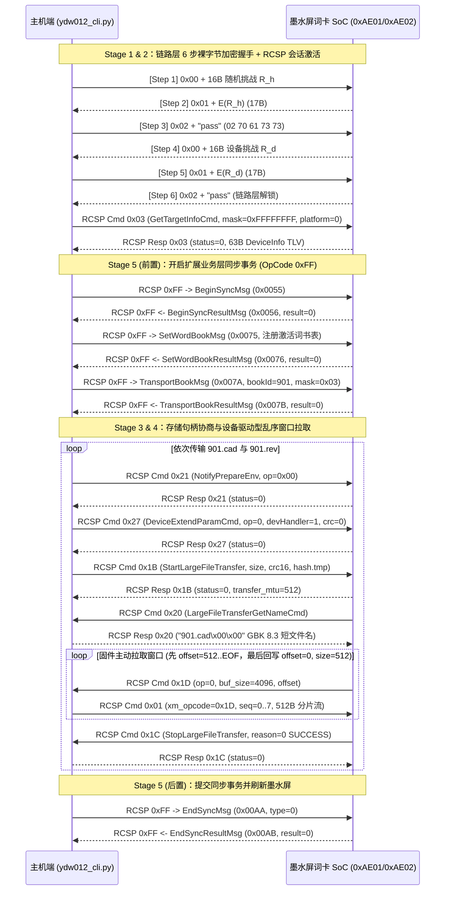

# 通用双模蓝牙墨水屏词卡 (YDW012 系列) 独立同步工具与嵌入式通信协议研究
# Generic Dual-Mode BLE E-Ink Word Card (YDW012 Series) Standalone Sync Tool & Protocol Study

[](LICENSE)
[](https://www.python.org/)
[](docs/REVERSE_ENGINEERING.md)

> ### ⚠️ 技术学习研究与免责声明 (Educational & Interoperability Disclaimer)
> 1. **研究目的**：本仓库及配套文档仅用于**嵌入式低功耗蓝牙 (BLE GATT) 通信协议学习、RCSP (Remote Control Serial Protocol) 状态机研究、二进制容器结构分析，以及个人合法持有硬件的互操作性（Interoperability）研究**。其初衷是解决老旧闲置墨水屏硬件因配套移动端软件停服或操作系统版本迭代导致无法继续加载个人学习词卡的兼容性问题，延长硬件生命周期并减少电子垃圾。
> 2. **独立实现 (Clean-Room Implementation)**：本项目所有代码均基于通用蓝牙通信状态机与字节流格式规范从零编写（100% 纯 Python 标准库 + `bleak`），**不包含任何第三方受版权保护的固件代码、闭源 SDK、拆包二进制库文件或专有词典数据**。仓库内置的两套示例词库（`sim4options_words.json` 与 `sim4director_words.json`）均为原创编写的开源中英双语专业概念学习卡。
> 3. **免责条款**：本项目按“原样 (AS IS)”提供，严禁用于任何商业用途、非法入侵或侵犯第三方知识产权的行为。使用者因运行本工具对个人硬件设备进行操作所产生的任何软硬件风险或数据损失，均由使用者自行承担。

---

## 目录 (Table of Contents)

- [硬件架构背景与核心特性](#硬件架构背景与核心特性)
- [通用双模蓝牙 SoC 五阶段标准处理流程](#通用双模蓝牙-soc-五阶段标准处理流程)
- [快速开始 (Quick Start)](#快速开始-quick-start)
- [嵌入式通信排障与 8 大关键技术突破点](#嵌入式通信排障与-8-大关键技术突破点)
- [五阶段状态机完整交互时序图 (Mermaid)](#五阶段状态机完整交互时序图-mermaid)
- [二进制词卡容器格式规范概览 (`.CAD` & `.REV`)](#二进制词卡容器格式规范概览-cad--rev)
- [仓库目录结构](#仓库目录结构)
- [深度协议技术手册](#深度协议技术手册)

---

## 硬件架构背景与核心特性

便携式墨水屏单词卡（如 `YDW012` 硬件系列）通常采用 **通用双模蓝牙音频/物联网 SoC（内置 FAT 文件系统管理与 RCSP 串行控制协议栈）** 搭配低功耗电子墨水屏（E-Ink）。在独立开发跨平台同步工具时，该类硬件架构具有两个典型特征：
1. **Type-C 接口纯供电设计**：板载 USB Type-C 母座仅焊接 VBUS 与 GND 至锂电池充电管理芯片，**未连接主控 SoC 的 USB D+/D- 数据差分线**（插入计算机执行 `lsusb` 无任何 USB 设备枚举），因此 BLE GATT 通道（`0xAE00`）是唯一的外部数据交互接口。
2. **多级状态机门控机制**：固件在 BLE 连接建立后并不会直接响应文件读写指令，而是依次通过 **链路层裸字节挑战-应答握手** -> **会话级能力掩码协商 (`0x03`)** -> **存储句柄扩展参数绑定 (`0x27`)** -> **设备驱动型乱序窗口拉取 (`0x1D`)** -> **业务层同步事务锁 (`0xFF`)** 五级状态机进行保护。

本项目将上述通用芯片通信流程与二进制容器格式整理为标准化的 **5 阶段处理管线**，并提供开箱即用的命令行工具 `ydw012_cli.py`：

- **自动发现周围设备 (`scan`)**：支持按 BLE 广播名称前缀（默认 `YDW:`，可通过 `--prefix` 自定义）或 GATT 主服务 UUID `0000ae00-0000-1000-8000-00805f9b34fb` 自动匹配设备，无需硬编码 MAC 地址。
- **链路层 6 步挑战-应答认证**：纯 Python 实现 8 轮双相 S-Box / Fibonacci 模乘置换分组密码与密钥调度器。
- **FAT 文件系统浏览与按簇无损导出 (`ls` / `pull`)**：支持遍历设备内置 Flash 上的 FAT 目录树（`/`、`/O/<book_id>/`）并按簇号导出任意 `.CAD` / `.REV` / `.STU` 文件（含逐包累加 CRC16-XMODEM 校验）。
- **100% 字节级精确 `.CAD` / `.REV` 编译器与校验器 (`build` / `inspect`)**：支持将任意自定义 JSON 词表编译为固件原生解析的 `<book_id>.cad`（正背面词卡数据库）与 `<book_id>.rev`（艾宾浩斯 `[0, 2, 6, 14, 29, 39]` 周期复习计划矩阵）。
- **内置两套原创双语专业学习词库**：
  - `examples/sim4options_words.json`：**130 个期权交易、希腊字母与波动率策略中英双语词卡**（示例 Book ID `901`）
  - `examples/sim4director_words.json`：**16 大分类共 341 个影视导演与镜头调度专业中英双语词卡**（示例 Book ID `902`）

---

## 通用双模蓝牙 SoC 五阶段标准处理流程

| 阶段 | 处理模块 | 涉及协议码 / 通道 | 核心作用 |
| :---: | :--- | :--- | :--- |
| **Stage 1** | **物理层与 GATT 通道发现** | Service `0xAE00`<br>Write `0xAE01` / Notify `0xAE02` | 识别纯供电 USB 架构，建立 BLE GATT 双向通知通道并协商 MTU |
| **Stage 2** | **链路层 6 步握手与会话激活** | Raw `0x00`/`0x01`/`0x02`<br>RCSP `OpCode 0x03` | 在 `0xAE01`/`0xAE02` 上完成 17B 裸字节双向挑战-应答，随后发送 `0x03` 激活 RCSP 会话状态机 |
| **Stage 3** | **存储介质挂载与扩展参数协商** | RCSP `OpCode 0x21` -> `0x27` | 准备文件传输环境 (`0x21`)，并通过 `0x27` 显式绑定目标 Flash/SD 存储句柄 (`devHandler=1, hasCrc16=0`) |
| **Stage 4** | **设备驱动型乱序窗口拉取与归档** | RCSP `0x1B` -> `0x20` -> `0x1D`/`0x01` -> `0x1C` | 响应 `0x20` GBK 8.3 短文件名，按固件 `0x1D` 请求动态切片推送（先写 `512..EOF`、最后回写 `0..512` 头部实现断电保护） |
| **Stage 5** | **二进制词卡编译与扩展事务提交** | RCSP `OpCode 0xFF`<br>(`0x0055` -> `0x0075` -> `0x007A` -> `0x00AA`) | 生成 `.CAD`/`.REV` 二进制容器，开启同步事务锁、注册词书元数据表、完成传输并提交刷新墨水屏 UI |

---

## 快速开始 (Quick Start)

### 1. 安装依赖

```bash
pip install -r requirements.txt
# 或者使用 uv:
uv pip install bleak
```

### 2. 唤醒设备并扫描蓝牙信号 (`scan`)

按一下单词卡侧边按键点亮墨水屏（确保设备未处于深度休眠状态），执行：

```bash
python3 ydw012_cli.py scan
```

输出示例：
```text
Scanning BLE for 8.0s (prefix='YDW:')...
  [MATCH] XX:XX:XX:XX:XX:XX  name='YDW:GD4170XXXXXXXXXX'  RSSI=-54  uuids=['0000ae00-0000-1000-8000-00805f9b34fb']
```

> **提示**：所有命令默认使用 `--addr auto` 自动扫描匹配设备；也可通过 `--addr XX:XX:XX:XX:XX:XX`、`--prefix <自定义前缀>` 或环境变量 `export YDW012_ADDR=XX:XX:XX:XX:XX:XX` 指定目标设备。

### 3. 查询设备当前词书与学习进度 (`info`)

```bash
python3 ydw012_cli.py info
```

### 4. 浏览设备 FAT 文件系统 (`ls`) 与按簇提取文件 (`pull`)

```bash
# 递归列出内置 Flash FAT 根目录与 /O/<book_id>/ 下的所有 .CAD / .REV / .STU 文件及其起始簇号 (cluster)
python3 ydw012_cli.py ls

# 按簇号从设备无损导出任意文件（带逐包累加 CRC16-XMODEM 校验）
python3 ydw012_cli.py pull 660 backup_513.cad
```

### 5. 本地编译并校验自定义词书 (`build` & `inspect`)

```bash
# 将 JSON 词表编译为 901.cad 和 901.rev
python3 ydw012_cli.py build \
  --json examples/sim4options_words.json \
  --book-id 901 \
  --title "sim4options期权双语" \
  --daily 15 \
  --out-dir ./build

# 解析并校验生成的二进制容器结构与 CRC16
python3 ydw012_cli.py inspect ./build/901.cad
python3 ydw012_cli.py inspect ./build/901.rev
```

### 6. 一键编译并通过蓝牙同步到单词卡 (`upload`)

```bash
# 默认编译并推送内置的两本双语词书 (901 期权双语 + 902 导演双语)，同时保留卡内已有词书 (最多共 4 本)
python3 ydw012_cli.py upload

# 或者指定任意自定义 JSON 词书上传：
python3 ydw012_cli.py upload \
  --book 901 "sim4options期权双语" examples/sim4options_words.json \
  --book 902 "sim4director导演双语" examples/sim4director_words.json
```

---

## 嵌入式通信排障与 8 大关键技术突破点

在研究该类通用双模蓝牙 SoC 墨水屏设备的通信机制过程中，我们定位并解决了 **8 个核心协议层陷阱**（完整字节级分析见 [`docs/REVERSE_ENGINEERING.md`](docs/REVERSE_ENGINEERING.md)）：

### 突破点 1：Type-C 接口纯供电无数据线判定
- **问题现象**：将设备通过全功能 Type-C 数据线接入电脑，`lsusb` 与内核日志无任何枚举响应。
- **原因与对策**：硬件仅将 Type-C 接口用于 5V 锂电池充电，未引出 USB D+/D- 信号线。所有词卡数据下发必须通过 BLE GATT 服务 `0xAE00`（Write `0xAE01` / Notify `0xAE02`）完成。

### 突破点 2：连接后直接发 RCSP 帧全部静默超时 (Silent Drop #1 — 缺少链路层 6 步握手)
- **问题现象**：订阅 `0xAE02` 后直接向 `0xAE01` 写入标准 RCSP 帧（`FE DC BA ... EF`），固件不返回任何响应，并在数秒后主动断开蓝牙连接。
- **原因与对策**：BLE 物理连接建立后，固件默认处于未认证隔离态，只接受**不含 `FE DC BA` 帧头的裸字节握手包**。主机必须先按以下 6 步完成双向挑战-应答：
  1. Host -> Card (`0xAE01`)：`0x00` + 16 字节随机挑战 `R_h`（17 字节）
  2. Card -> Host (`0xAE02`)：`0x01` + `E(R_h)`（17 字节，Host 校验设备）
  3. Host -> Card (`0xAE01`)：`02 70 61 73 73`（即 `b"\x02pass"`，5 字节）
  4. Card -> Host (`0xAE02`)：`0x00` + 16 字节设备随机挑战 `R_d`（17 字节）
  5. Host -> Card (`0xAE01`)：`0x01` + `E(R_d)`（17 字节，设备校验 Host）
  6. Card -> Host (`0xAE02`)：`02 70 61 73 73`（`b"\x02pass"`，链路层解锁成功）

### 突破点 3：握手通过后发业务指令或目录浏览依然静默丢弃 (Silent Drop #2 — 缺少 `GetTargetInfoCmd 0x03`)
- **问题现象**：完成 6 步握手收到 `02 70 61 73 73` 后，直接发送 `0xFF` 扩展业务消息或 `0x0C` 目录浏览指令，固件依然静默丢弃。
- **原因与对策**：握手完成后，**第一条 RCSP 指令必须是 `GetTargetInfoCmd (OpCode=0x03, param=0xFFFFFFFF00)`**（完整帧 `FE DC BA C0 03 00 06 01 FF FF FF FF 00 EF`）。固件只有在返回 63 字节设备能力 TLV 响应后，才会正式激活 RCSP 会话状态机。

### 突破点 4：大文件传输启动 `StartLargeFileTransfer (0x1B)` 返回 `status=1` 报错 (Pitfall #3 — 缺少 `DeviceExtendParamCmd 0x27`)
- **问题现象**：发送 `NotifyPrepareEnv (0x21, param=0x00)` 后直接发送 `StartLargeFileTransfer (0x1B)`，固件立即返回 `status=1` 拒绝写入。
- **原因与对策**：SoC 支持多个存储介质句柄（内部 Flash、外部 SPI NorFlash、SD 卡等）。在 `0x21` 与 `0x1B` 之间**必须插入 `DeviceExtendParamCmd (OpCode=0x27)`**，参数为 `struct.pack(">BIB", 0x00, dev_handler, 0x00)`（即 `00 00 00 00 01 00`，指定 `op=0` 大文件传输、`devHandler=1` 目标存储句柄、`hasCrc16=0`）。加入 `0x27` 后，`0x1B` 立即返回 `status=0, transfer_mtu=512`。

### 突破点 5：文件名回调 `LargeFileTransferGetNameCmd (0x20)` 编码规则 (Pitfall #4 — 8.3 短文件名 vs UTF-16LE)
- **问题现象**：`0x1B` 握手成功后，固件主动发送 `OpCode=0x20` 向主机请求文件名。若使用 UTF-16LE 或长文件名 `\U` 前缀，固件无法将文件归入正确的词书目录。
- **原因与对策**：对于主文件名 `< 9` 字节且扩展名 `< 5` 字节的标准 DOS **8.3 短文件名**（如 `901.cad`、`901.rev`），主机必须直接返回 **`filename.encode("gbk") + b"\x00\x00"`**（如 `39 30 31 2E 63 61 64 00 00`）。固件底层文件归档器会自动识别数字前缀 `901` 并在 FAT 文件系统中创建 `/O/901/901.CAD` 与 `/O/901/901.REV`。

### 突破点 6：固件 `0x1D` 偏移量乱序拉取机制（先写 `512..EOF`，最后回写 `0..512` 文件头）
- **问题现象**：若主机端假定固件按 `offset = 0, 4096, 8192...` 顺序拉取数据，写入后的文件将无法通过校验。
- **原因与对策**：固件在 `LargeFileTransferOpCmd (0x1D)` 中采用了经典的**嵌入式断电保护提交策略（Atomic Header Commit）**：
  - 第 1 次拉取请求：`offset = 512, buf_size = 4096`
  - 第 2..N-1 次拉取请求：`offset = 4608, 8704, ...` 直至文件末尾 `EOF`
  - **最后一次拉取请求**：`offset = 0, buf_size = 512`！
  通过将前 512 字节文件头留到最后写入，可防止蓝牙中途断连在 Flash 上留下半截具有合法 Header 的损坏文件。主机必须严格依据每次 `0x1D` 请求中的 `offset` 与 `buf_size` 动态切片 `file_bytes[offset : offset + buf_size]`。

### 突破点 7：业务层同步事务锁 (`BeginSync 0x0055` -> `SetWordBook 0x0075` -> `TransportBook 0x007A` -> `EndSync 0x00AA`)
- **问题现象**：如果仅通过 RCSP 大文件传输将 `.cad` 和 `.rev` 写入 Flash，墨水屏 UI 菜单不会显示新词书。
- **原因与对策**：必须通过 `OpCode = 0xFF` 扩展业务通道执行完整的 4 步事务：
  1. 发送 `BeginSyncMsg (0x0055)` 锁定 UI 进入同步界面；
  2. 发送 `SetWordBookMsg (0x0075)` 一次性写入最多 4 本激活词书的 31 字节元数据描述符数组及当前选中词书 ID；
  3. 对每本待传词书，先发送 `TransportBookMsg (0x007A, bookId, bookType=1, fileMask=3)` 声明即将上传 `.cad` (`bit0`) 与 `.rev` (`bit1`)，收到 `0x007B` 响应后依次上传 `<id>.cad` 与 `<id>.rev`；
  4. 全部完成后发送 `EndSyncMsg (0x00AA, type=0)` 提交事务并触发墨水屏重绘。

### 突破点 8：`.CAD` 与 `.REV` 偏移指针表与艾宾浩斯复习矩阵完整还原
- **原因与对策**：通过 `0x0C` 目录浏览与 `0x24` 按簇读取功能导出真实样本进行字节级验证，100% 还原了 `.CAD` 的 4 区段绝对偏移表结构与 `.REV` 的艾宾浩斯复习计划生成算法，并通过自动化往返测试验证了字节一致性。

---

## 五阶段状态机完整交互时序图 (Mermaid)



---

## 二进制词卡容器格式规范概览 (`.CAD` & `.REV`)

### 1. `.CAD` 词卡容器结构 (Little-Endian)

| 区段 | 偏移范围 | 字段布局与说明 |
| :--- | :--- | :--- |
| **Header** | `0x00 .. 0x83` (132 B) | `<6I` (`rsv0=0, rsv1=0, sec1_off=0x84, meta_off, sec2_off, rsv2=0`) + 108 字节 `0x00` 填充 |
| **Section 1 (正面词头表)** | `sec1_off .. meta_off-1` | `<II` (`N`, `0`) + `N` 个 `<I` 记录绝对偏移指针 + `N` 个 **59 字节定长记录** (`<II` `w_len, w_off` + 其余音标/音频扩展槽指向 `w_off+w_len`) + 紧凑拼接的 UTF-8 词头字节流 |
| **Metadata Block (词书元数据)** | `meta_off .. sec2_off-1` | `<IQQIIIIQ` (44 B: `ver=1, book_id, ts_ms, 0, lang=13, cat=3, title_len, title_off=meta_off+44`) + UTF-8 词书标题字节 |
| **Section 2 (背面释义表)** | `sec2_off .. EOF` | `<II` (`N`, `0`) + `N` 个 `<I` 记录绝对偏移指针 + `N` 个 **37 字节定长记录** (`<II` `d_len, d_off` + 3 个空槽指向 `d_off+d_len` + 5B `0x00`) + 紧凑拼接的 UTF-8 双语释义字节流 |

### 2. `.REV` 艾宾浩斯复习计划结构 (Little-Endian)

| 区段 | 偏移范围 | 字段布局与说明 |
| :--- | :--- | :--- |
| **Header** | `0x00 .. 0x37` (56 B) | `<QQQQQIIII` (`ver=1, book_id, ts1_ms, ts2_ms, daily_words=15, N, sec1_off=0x38, sec2_off, 0`) |
| **Section 1 (词头索引)** | `0x38 .. sec2_off-1` | `N` 个 `<HI` (`w_len`, `w_off`) + 紧凑 UTF-8 词头字节流 |
| **Section 2 (艾宾浩斯日程表)** | `sec2_off .. EOF` | `<I` (`K = ceil(N / daily_words) + 40`) + `K` 个 `<HI` (`s_len`, `s_off`) + 每日复习词号 ASCII 逗号分隔字符串（按艾宾浩斯间隔 `d - offset in [0, 2, 6, 14, 29, 39]` 生成 1-based 词号列表） |

---

## 仓库目录结构

```text
.
├── README.md                        # 项目主文档、五阶段通用处理流程与排障总结
├── LICENSE                          # MIT 开源许可证
├── pyproject.toml                   # Python 包配置与命令行入口 (ydw012 / eink-card)
├── requirements.txt                 # 依赖声明 (bleak>=0.21.0)
├── ydw012_cli.py                    # 独立全功能 BLE 同步、FAT 浏览与 .CAD/.REV 编译器
├── docs/
│   └── REVERSE_ENGINEERING.md       # 通用双模蓝牙 SoC 协议栈与二进制容器技术手册
├── examples/
│   ├── sim4options_words.json       # 原创双语词库 1：130 个期权交易与策略中英双语词卡
│   └── sim4director_words.json      # 原创双语词库 2：341 个影视导演与镜头调度中英双语词卡
└── tests/
    └── test_cad_rev_roundtrip.py    # 握手算法、RCSP 封包及 .CAD/.REV 编译-解析往返单元测试
```

---

## 深度协议技术手册

有关链路层 8 轮双相置换密码算法、RCSP 操作码全集、`0xFF` 扩展业务消息结构体以及 `.CAD` / `.REV` 字节级规范的完整技术细节，请参阅：

👉 **[`docs/REVERSE_ENGINEERING.md`](docs/REVERSE_ENGINEERING.md)**

---

> **免责声明重申**：本仓库所有内容仅供嵌入式通信协议学习与个人硬件互操作性研究，与任何硬件或软件厂商无关。请遵守当地法律法规，勿将本工具用于商业或侵权用途。
